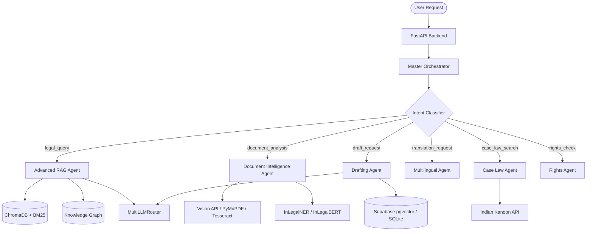

# Legal RAG Agent 🏛️
### Agentic Indian Legal Intelligence Platform


---

## The Problem

India has **50+ million pending court cases**. Most citizens cannot afford a lawyer. Legal documents are written in language ordinary people do not understand. When someone's landlord illegally withholds their deposit, their employer steals their wages, or they face a false case — they have nowhere to turn.

Existing tools fail in every way that matters:
- Search engines return PDFs no one can read
- Generic AI chatbots hallucinate section numbers and punishments
- No tool understands scanned Indian legal documents
- No tool is aware of jurisdiction-specific state laws
- No multilingual support for regional languages

---

## Table of Contents

- [The Problem](#the-problem)
- [Overview](#overview)
- [Features](#features)
- [Architecture](#architecture)
- [Tech Stack](#tech-stack)
- [Prerequisites](#prerequisites)
- [Installation](#installation)
- [Configuration](#configuration)
- [Usage](#usage)
- [API Reference](#api-reference)
- [Project Structure](#project-structure)
- [Running Tests](#running-tests)
- [Deployment](#deployment)
- [Authentication](#authentication)


---

## Overview

Legal RAG Agent is an end-to-end legal empowerment platform serving common citizens who face a regional language barrier and the inaccessibility of legal help amidst India's 50 million pending court cases. It solves the critical problem of legal illiteracy by providing immediate, reliable, and accessible legal guidance.

The system can transform a scanned document photograph into a cited legal explanation in Malayalam—or other supported languages—in under 60 seconds. The platform uses a specialized multi-agent workflow (LangGraph), advanced RAG with hybrid search and CRAG self-correction, and document intelligence (OCR, NLP, NER) to demystify Indian laws. 

Legal RAG Agent is specifically optimized to run entirely on consumer-grade hardware (CPU-only inference) utilizing free-tier APIs, ensuring zero-cost operations for public empowerment. The platform uses a custom domain with SEO enhancements and Google Search Console integration to ensure citizens can easily discover the tool when searching for legal aid.

---

## Features

### Core Capabilities
* **Advanced RAG Pipeline**: Multi-hop decomposition, CRAG self-correction, era-aware synthesizers (IPC vs BNS), and knowledge graph enrichment.
* **Document Intelligence**: Deep analysis of uploaded documents via PyMuPDF (digital), pdfplumber (tables), Google Cloud Vision API (primary OCR for scans), and Tesseract (fallback OCR), combined with custom NER/classifiers to assess risk and detect rights violations.
* **Stateful Drafting Agent**: Human-in-the-loop multi-turn guided flow that drafts legal complaints across 8 distinct categories, complete with **WeasyPrint-powered PDF export** for generating ready-to-file documents.
* **Case Law Search**: Live integration with Indian Kanoon to retrieve real precedent and summaries.
* **Rights Module**: Static and dynamic lookups to educate users on Tenant, Employee, Consumer, Women, and Bail rights.

### Mobile Responsiveness & Polish
* The entire platform UI (including Chat, Document Analysis, Draft, Rights, and Case Law views, as well as Modals and Toasts) has undergone a complete mobile overhaul, providing a native-feeling application experience on mobile browsers.

### Multilingual Support
* **5 Supported Languages**: English, Malayalam, Hindi, Tamil, and Telugu.
* **Seamless Translation**: Translates queries into English for retrieval and translates responses back to the native tongue while strictly preserving legal entity names in English.

---

## Architecture

Legal-RAG-Agent uses a **Central Orchestrator and Specialized Agents** pattern. The Master Orchestrator intercepts requests and utilizes a LangGraph `StateGraph` to conditionally route execution to the appropriate specialized node based on intent.



---

## Tech Stack

| Layer | Technology | Purpose |
|---|---|---|
| **Backend** | FastAPI + Uvicorn | High-performance async REST API server |
| **Agent Framework** | LangGraph | Stateful multi-agent workflow orchestration |
| **LLM Routing** | MultiLLMRouter | 7-provider cascading fallback router (`groq-llama33-70b` primary, openrouter fallback chain, `gemini-2.0-flash` redundancy) |
| **Embeddings** | sentence-transformers | `all-MiniLM-L6-v2` for CPU-optimized semantic queries |
| **Legal NLP** | InLegalBERT / InLegalNER | Legal embeddings, doc classification, and NER |
| **Vector Database**| ChromaDB / BM25 | Hybrid search (sparse and dense retrieval) |
| **OCR & Vision** | Google Cloud Vision API, PyMuPDF, pdfplumber, Tesseract | Primary document intelligence stack with digital, scanned, and fallback contingencies |
| **Session Memory** | Supabase pgvector / SQLite | Supabase Postgres (semantic memory) for production; SQLite for local dev persistence |
| **Observability** | LangSmith | Execution tracing, latency, and token monitoring |
| **Frontend** | React 18 + Vite | Fast, responsive single-page user interface |

---

## Prerequisites

* **Python**: `≥ 3.10`
* **Node.js**: `≥ 18.x`
* **Google Cloud Project**: Required for Google Cloud Vision API (primary OCR).
* **Tesseract OCR**: Installed on your system with English, Malayalam (`mal`), and Hindi (`hin`) language packs. (Used as a secondary/tertiary emergency fallback).
* **Poppler**: Required by `pdf2image`.

---

## Installation

```bash
# 1. Clone the repository
git clone https://github.com/AnshikaJ69/Legal-RAG-Agent.git
cd Legal-RAG-Agent

# 2. Setup Python Backend Environment
python -m venv venv
# Windows
venv\Scripts\activate
# Linux/Mac
source venv/bin/activate

# 3. Install Python Dependencies
pip install --no-cache-dir -r requirements.txt

# 4. Setup Frontend Environment
cd frontend
npm install
cd ..
```

---

## Configuration

Legal RAG Agent relies heavily on external APIs. Create a `.env` file in the root directory by copying the example:

```bash
cp .env.example .env
```

### Environment Variables

| Variable | Required | Default | Description |
|---|---|---|---|
| `GROQ_API_KEY` | Yes | - | Primary LLM (LLaMA 3.3 70B via Groq) |
| `GEMINI_API_KEY` | Yes | - | Primary for DraftingAgent, Fallback for RAG |
| `NVIDIA_API_KEY` | No | - | Optional, for Reranking via NIM |
| `INDIANKANOON_API_KEY` | No | - | Required for real-time Case Law searches |
| `RESEND_API_KEY` | Yes | - | Email delivery for verification and password reset |
| `DATABASE_URL` | Required in production | - | Postgres connection (e.g., Supabase URL). Use SQLite or local Postgres for local dev. |
| `GOOGLE_APPLICATION_CREDENTIALS` | Dev | - | Service account JSON path for Google Cloud Vision API (local dev). In production Cloud Run, uses Application Default Credentials. |
| `ENABLE_CASE_LAW_ENRICHMENT`| No | `true` | Set `false` to skip Case Law calls entirely |
| `LANGCHAIN_TRACING_V2` | No | `false` | Enable to `true` for LangSmith tracing |
| `LANGCHAIN_API_KEY` | No | - | LangSmith trace key |
| `LANGCHAIN_PROJECT` | No | `Legal-RAG-Agent ` | LangSmith project name |
| `JWT_SECRET_KEY` | Yes | - | Secure 32-char string for Auth tokens |
| `ALLOWED_ORIGINS` | No | `http://localhost:3000,...` | CORS origins |

---

## Usage

### Running Locally

To run the application locally, you'll need two terminal windows:

**Terminal 1: Start Backend (FastAPI)**
```bash
# Ensure virtual environment is active
uvicorn api.main:app --reload --port 8000
```

**Terminal 2: Start Frontend (React/Vite)**
```bash
cd frontend
npm run dev
```

Navigate your browser to `http://localhost:5173`.

---

## API Reference

The backend exposes over 20 endpoints for various capabilities. Swagger documentation is available natively at `http://localhost:8000/docs` when the server is running.

### Key Endpoints

* `GET /health` — Check system health, DB counts, LLM pings, and tracing status.
* `POST /auth/login` — Generate JWT tokens.
* `POST /orchestrator/chat` — Main agentic entry point. Expects JSON `{ "query": "..." }`.
* `POST /document/analyze` — Upload PDF/Images for OCR and NLP analysis (multipart/form-data).
* `POST /legal/query` — Direct access to the RAG pipeline.

Authentication via Bearer token is handled across protected routes.

---

## Project Structure

```text
Legal-RAG-Agent /
├── agents/           # LangGraph workflows, nodes, intent routers, and agents
├── api/              # FastAPI entry points, CORS, routers (auth, document, etc.)
├── cv/               # Computer Vision pipelines (OCR, PDF layout analysis)
├── data/             # Vector stores, SQLite memory DBs, Graph JSONs, raw text
├── evals/            # Custom RAGAS pipeline and evaluation tools
├── frontend/         # React SPA (Vite)
├── logs/             # System and execution logs
├── models/           # Custom NLP classifiers and Risk Scorers
├── nlp/              # NER pipelines and entity extractors
├── rag/              # CRAG, Embedders, Vector DB handlers, Synthesizers
├── tests/            # Pytest suite and automated evaluations
├── docker-compose.yml# Container orchestration config
├── Dockerfile        # Python application build script
└── requirements.txt  # Python pip dependencies
```

---

## Running Tests

Legal RAG Agent employs a custom test suite checking the vector store, DB memory, graph execution, and agent relevance logic.

```bash
# Run all tests using pytest
pytest

# Run a specific test file
pytest tests/test_relevance.py

# Run RAG evaluation framework specifically
python tests/run_evals.py
```

---

## Deployment

Legal RAG Agent operates a fully automated production deployment environment utilizing cloud-native services.

### Production Architecture
* **Frontend**: Built with React and Vite
* **Backend**: Containerized FastAPI service running on **Google Cloud Run** (CPU-only tier). 
* **Database**: **Supabase PostgreSQL** utilizing `pgvector` extensions for semantic session memory and history retrieval.
* **Document Processing**: Uses **Google Cloud Vision API** for enterprise-grade OCR on uploaded scans (no local OCR models exist in the production environment).
* **Storage Artifacts**: Large machine learning artifacts (ChromaDB vector indices, InLegalBERT models, BM25 indices) are persisted in **Google Cloud Storage (GCS)** and dynamically downloaded at container startup.
* **CI/CD Pipeline**: GitHub Actions workflows handle automated linting, building, and deployments. A push to the `main` branch triggers automatic rollout to both Firebase Hosting and Cloud Run.

### Local Deployment
For local development, Legal RAG Agent provides a containerized setup via Docker Compose:

```bash
# Build and run using Docker Compose
docker-compose up --build -d
```

**Docker Services:**
* `api`: Builds the FastAPI application mapped to port `8000`.
* `postgres`: Local PostgreSQL instance for session memory.
* `chromadb`: Maps a persistent ChromaDB instance mapped to port `8001`, volume-mounted to `./data/chroma`.

---

## Authentication

Legal RAG Agent enforces robust security for user sessions:
* **Account Lifecycle**: Supports secure sign-ups, comprehensive email verification flows, and authenticated password resets.
* **Email Delivery**: Uses the **Resend API** for reliable transactional email delivery (verifications and resets).
* **Security & Tokens**: Implements JSON Web Token (JWT) based authentication with stateless authorization mechanisms. Passwords are securely hashed using `bcrypt` before storage.

---

